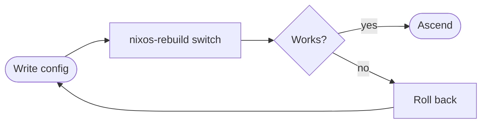

<div align="center">


</div>

<br/>

> [!IMPORTANT]
> **"Agrona, you've tested my patience long enough. You have ten seconds."**

```bash
for i in {10..1}; do echo "$i..."; sleep 1; done
sudo nixos-rebuild switch --flake .#grey
```

<br/>

<table>
<tr>
<td width="50%" valign="top">

### About

I build my whole system as code: one config, fully reproducible. If it breaks, I roll back and start over. Reborn, with the memories intact.

- Maintaining [`nixos-hyprland-vfio`](https://github.com/kUmutUK/nixos-hyprland-vfio)
- Stack: NixOS, flakes, Hyprland, Shell
- Linux gaming with AMD tweaks and single-GPU passthrough
- Find me on [X](https://x.com/umpugg)

</td>
<td width="50%" valign="top">

### Abilities

| Ability | Source |
|:--|:--|
| **Beast Will** | NixOS + flakes |
| **Realmheart** | Hyprland |
| **Aether** | AMD / gaming tweaks |
| **Regis** | VFIO passthrough |
| **Blade** | Bash / Shell |

</td>
</tr>
</table>

### The Cycle



<br/>

### Arsenal

<div align="center">


<br/><br/>


</div>

<br/>

### Featured

<div align="center">

<a href="https://github.com/kUmutUK/nixos-hyprland-vfio">
  
</a>
<a href="https://github.com/kUmutUK/system">
  
</a>

</div>

<br/>

### Stats

<div align="center">


</div>

<br/>

<details>
<summary><b>Words of the King</b></summary>

<br/>

> *"I was a king once. I know exactly what it costs to kneel."*
>
> *"You mistook my silence for mercy."*
>
> *"Run. It will make the ending more interesting."*
>
> *"Every scar you gave me taught me where to cut you."*
>
> *"I have died before. It did not stop me then either."*
>
> *"Rebuild failed? Good. Now I'm angry."*

</details>

<br/>


